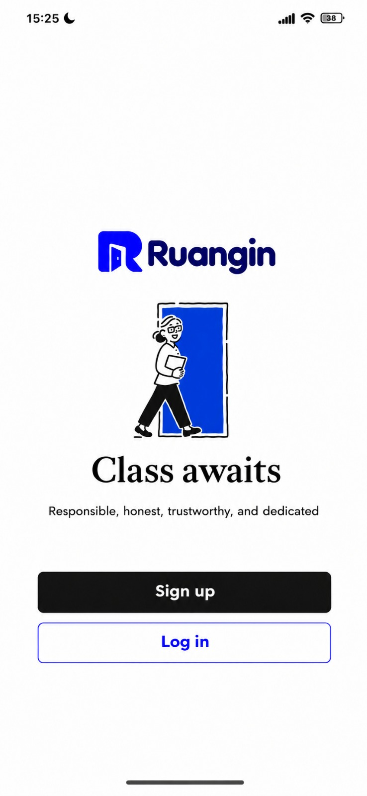

# Ruangin - Timeline Jadwal Mengajar Dosen Lintas Prodi

<div align="center">



**Ruangin** adalah aplikasi mobile Flutter yang memudahkan mahasiswa menemukan jadwal mengajar dosen dari berbagai prodi dalam satu kampus, lengkap dengan informasi ruang terkini dan notifikasi perubahan.

[📱 Fitur](#fitur-utama) • [🚀 Instalasi](#instalasi) • [⚙️ Konfigurasi](#konfigurasi) • [🧪 Testing](#testing) • [📚 Dokumentasi](#dokumentasi)

</div>

---

## 📋 Daftar Isi

- [Tentang Ruangin](#tentang-ruangin)
- [Fitur Utama](#fitur-utama)
- [Tech Stack](#tech-stack)
- [Prerequisites](#prerequisites)
- [Instalasi](#instalasi)
- [Konfigurasi](#konfigurasi)
- [Menjalankan Aplikasi](#menjalankan-aplikasi)
- [Testing](#testing)
- [Build Produksi](#build-produksi)
- [Struktur Proyek](#struktur-proyek)
- [Troubleshooting](#troubleshooting)
- [Contributing](#contributing)

---

## 📱 Tentang Ruangin

Ruangin adalah solusi untuk masalah umum di kampus: **mahasiswa kesulitan mengetahui kapan dan di mana seorang dosen mengajar**, terutama dosen dari prodi lain. 

Aplikasi ini menampilkan timeline jadwal mengajar per dosen yang tersinkronisasi dengan catatan absensi kampus, sehingga mahasiswa dapat:
- ✅ Menemukan dosen lintas prodi dengan cepat
- ✅ Melihat jadwal terbaru dan perubahan ruang/waktu
- ✅ Mengikuti sesi untuk mendapat notifikasi perubahan
- ✅ Melaporkan ruangan kosong untuk mahasiswa lain
- ✅ Mendapat peringatan dini jika ada perubahan

**Status Produk**: Milestone 1 (M1) - Demo dengan data sintetis lokal

---

## ✨ Fitur Utama

### Mahasiswa
- 🔍 **Cari Dosen** - Cari dosen berdasarkan nama dari berbagai prodi
- 📅 **Timeline Dosen** - Lihat jadwal mengajar dosen per tanggal
- 📍 **Detail Sesi** - Informasi ruang, jam, status, dan waktu update terakhir
- 👥 **Ikuti Sesi** - Dapatkan notifikasi untuk sesi yang Anda ikuti
- 🚨 **Lapor Ruangan Kosong** - Bantu mahasiswa lain dengan melaporkan ruangan yang kosong
- ⏰ **Peringatan Dini** - Notifikasi jika sesi sebelumnya belum terkonfirmasi

### Dosen & Petugas Akademik
- ✏️ **Edit Sesi** - Ubah jam, ruang, atau status sesi
- ✔️ **Konfirmasi Kehadiran** - Tandai sesi sebagai "Tercatat" atau "Belum Terkonfirmasi"
- 🔄 **Kelola Laporan** - Konfirmasi atau tolak laporan ruangan kosong

---

## 🛠️ Tech Stack

### Frontend
- **Framework**: Flutter 3.13.5+
- **Language**: Dart
- **State Management**: Provider 6.1.5+
- **Storage**: SharedPreferences 2.5.6+
- **Utilities**:
  - `intl`: Internationalization & date formatting
  - `crypto`: Password hashing (bcrypt)
  - `cupertino_icons`: iOS-style icons

### Development
- **Linting**: flutter_lints 6.0.0
- **Testing**: flutter_test

### Design
- **Font**: Jost, SourceSerif4
- **Icons**: Material Icons + Cupertino Icons

---

## 📋 Prerequisites

Sebelum memulai, pastikan Anda telah menginstall:

### Minimal Requirements
- **Flutter**: 3.13.5 atau lebih baru
- **Dart**: 3.13.5 atau lebih baru
- **Android SDK**: API level 21 atau lebih baru (untuk Android development)
- **Git**: Untuk version control

### Rekomendasi
- **IDE**: Android Studio, VS Code + Flutter extensions, atau IntelliJ IDEA
- **Git**: untuk cloning repository dan version control
- **JDK**: Java Development Kit 11 atau lebih baru

### Verifikasi Instalasi

```bash
# Verifikasi Flutter
flutter --version

# Verifikasi Dart
dart --version

# Verifikasi Android SDK
flutter doctor
```

Jika ada yang belum terinstall, jalankan `flutter doctor` untuk melihat detailed instructions.

---

## 🚀 Instalasi

### 1. Clone Repository

```bash
git clone https://github.com/FIKY0911/ruangin.git
cd ruangin
```

### 2. Navigasi ke Folder Aplikasi

```bash
cd app
```

### 3. Install Dependencies

```bash
# Download dependencies dari pubspec.yaml
flutter pub get

# (Optional) Update dependencies ke versi terbaru
flutter pub upgrade
```

### 4. Verifikasi Setup

```bash
# Jalankan Flutter Doctor untuk verifikasi setup
flutter doctor -v

# Jika ada error, ikuti instruksi yang ditampilkan
```

---

## ⚙️ Konfigurasi

### Konfigurasi Dasar

Tidak ada konfigurasi khusus yang diperlukan untuk menjalankan aplikasi dalam mode development dengan data lokal. Semua konfigurasi sudah tersedia di dalam kode.

### Konfigurasi Android (Android Studio / Android SDK)

1. **Buka Aplikasi di Android Studio**
   ```bash
   flutter pub global activate fvm  # (Optional) Flutter Version Manager
   open -a "Android Studio" .
   ```

2. **Verifikasi Android SDK**
   - Buka: **Android Studio → Preferences → Appearance & Behavior → System Settings → Android SDK**
   - Pastikan **API Level 21+** sudah terinstall

3. **Virtual Device Setup** (untuk emulator)
   - Buka: **Android Studio → Device Manager → Create Device**
   - Pilih device yang sesuai (e.g., Pixel 4, API 31)
   - Jalankan emulator

### Konfigurasi iOS (Opsional)

Aplikasi ini fokus pada Android untuk M1. iOS support bisa ditambahkan di fase development selanjutnya.

### Environment Variables (Opsional)

Jika ada API atau configuration khusus, tambahkan file `.env` di folder `app/`:

```bash
# app/.env
API_BASE_URL=http://localhost:3000
API_TIMEOUT=30
DEBUG_MODE=true
```

Kemudian load di `lib/main.dart`:

```dart
import 'dart:async';
// Load environment variables jika ada integration dengan backend
```

---

## 🎮 Menjalankan Aplikasi

### Mode Development

```bash
# Jalankan di emulator/device yang sudah connect
flutter run

# Jalankan dengan output verbose (untuk debugging)
flutter run -v

# Jalankan dengan hot reload aktif (default)
# Press 'r' untuk hot reload, 'R' untuk restart, 'q' untuk quit
```

### Mode Release (Android APK)

```bash
# Build APK untuk testing
flutter build apk

# Output: build/app/outputs/flutter-apk/app-release.apk

# Install ke connected device
flutter install

# Atau build dan langsung run
flutter run --release
```

### Menjalankan di Device Fisik

1. **Enable Developer Mode** pada Android device Anda
2. **Enable USB Debugging**
3. **Connect via USB** ke computer
4. Jalankan `flutter devices` untuk verifikasi device terdeteksi
5. Jalankan `flutter run`

---

## 🧪 Testing

### Menjalankan Unit Tests

```bash
# Run semua tests
flutter test

# Run dengan coverage
flutter test --coverage

# Run test spesifik
flutter test test/auth_service_test.dart

# Run dengan verbose output
flutter test -v
```

### Test Files

Aplikasi sudah dilengkapi dengan 54 test files yang mencakup:

| Test File | Cakupan |
|-----------|---------|
| `auth_service_test.dart` | Authentication logic & session management |
| `auth_validators_test.dart` | Input validation untuk login/register |
| `auth_controllers_test.dart` | Auth UI controller logic |
| `password_hasher_test.dart` | Password hashing & verification |
| `session_service_test.dart` | Session state & permissions |
| `search_test.dart` | Dosen search functionality |
| `timeline_test.dart` | Timeline & schedule logic |
| `follow_test.dart` | Follow/unfollow session logic |
| `auth_flow_widget_test.dart` | Auth UI integration |

### Menjalankan Widget Tests

```bash
# Run widget tests
flutter test test/auth_flow_widget_test.dart

# Run dengan debugging
flutter test -v test/auth_flow_widget_test.dart
```

### Code Analysis

```bash
# Analyze code untuk potential issues
flutter analyze

# Format code sesuai Dart style guide
dart format lib/ test/

# Fix issues otomatis
dart fix --apply lib/
```

---

## 📦 Build Produksi

### Build APK untuk Production

```bash
# Build signed APK (memerlukan keystore)
flutter build apk --release

# Build universal APK
flutter build apk --split-per-abi

# Build bundle untuk Google Play Store
flutter build appbundle --release

# Output di: build/app/outputs/bundle/release/app-release.aab
```

### Signing Release Build

Untuk mendistribusikan APK, Anda perlu sign dengan keystore:

```bash
# Generate keystore (jika belum ada)
keytool -genkey -v -keystore ~/upload-keystore.jks -keyalg RSA -keysize 2048 -validity 10950 -alias upload

# Reference keystore di build
# Edit: android/app/build.gradle.kts atau gunakan Flutter's guide
```

Lihat dokumentasi lengkap di: [Flutter App Signing](https://flutter.dev/docs/deployment/android)

---

## 📂 Struktur Proyek

```
ruangin/
├── README.md                      # File ini
├── docs/
│   ├── PRD-Ruangin.md             # Product Requirements Document
│   └── design/                    # Design mockups (login, register, welcome)
├── assets/                        # Shared assets
│   └── images/
├── app/                           # Aplikasi Flutter utama
│   ├── lib/
│   │   ├── main.dart              # Entry point aplikasi
│   │   ├── app.dart               # App configuration & routing
│   │   ├── core/                  # Core utilities & constants
│   │   │   ├── brand.dart         # Branding constants
│   │   │   ├── clock.dart         # Time utilities
│   │   │   ├── formatters.dart    # Data formatting
│   │   │   ├── result.dart        # Result type for error handling
│   │   │   └── view_state.dart    # UI state management
│   │   ├── data/
│   │   │   ├── fixtures/          # Sample/seed data
│   │   │   ├── local/             # Local storage (SharedPreferences)
│   │   │   ├── models/            # Data models (Account, Session, etc)
│   │   │   └── repositories/      # Data access layer
│   │   ├── domain/                # Business logic
│   │   │   ├── auth_service.dart  # Authentication business logic
│   │   │   ├── session_service.dart # Session management
│   │   │   └── ...                # Other domain services
│   │   ├── presentation/          # UI Layer
│   │   │   ├── auth/              # Authentication screens
│   │   │   │   ├── login_screen.dart
│   │   │   │   ├── register_screen.dart
│   │   │   │   └── welcome_screen.dart
│   │   │   ├── home/              # Home screen
│   │   │   ├── session/           # Session detail & follow
│   │   │   ├── search/            # Search screen
│   │   │   ├── notifications/     # Notifications center
│   │   │   ├── theme/             # App theme & styling
│   │   │   └── widgets/           # Reusable UI components
│   │   ├── schedule_dependencies.dart # Dependency injection setup
│   │   └── android/               # Android-specific configuration
│   ├── test/                      # Test files
│   ├── pubspec.yaml               # Flutter dependencies
│   ├── pubspec.lock               # Locked dependency versions
│   ├── README.md                  # App README (additional info)
│   ├── analysis_options.yaml      # Lint rules configuration
│   └── build/                     # Build output (generated)
└── android/                       # Android native code (if any)
```

### Key Directories

| Direktori | Purpose |
|-----------|---------|
| `lib/core/` | Utilities, constants, formatters, error handling |
| `lib/data/` | Data models, local storage, repositories |
| `lib/domain/` | Business logic, services, validators |
| `lib/presentation/` | UI screens, widgets, controllers, theming |
| `test/` | Unit tests, widget tests, integration tests |

---

## 🐛 Troubleshooting

### Common Issues

#### 1. `flutter pub get` Error
```bash
# Clean cache dan retry
flutter clean
cd app
flutter pub get
```

#### 2. Android Build Error
```bash
# Clean build
flutter clean
rm -rf build/

# Retry build
flutter build apk --release
```

#### 3. Device Not Detected
```bash
# List devices
flutter devices

# If empty, restart ADB
adb kill-server
adb start-server
adb devices
```

#### 4. Hot Reload Tidak Bekerja
```bash
# Stop dan restart flutter
# Press 'q' untuk quit
# Jalankan lagi: flutter run
```

#### 5. Emulator Lambat
- Gunakan emulator dengan API level yang lebih tinggi
- Pastikan hardware acceleration enabled di Android Studio
- Gunakan device fisik untuk development lebih cepat

#### 6. Permission Denied (Linux/Mac)
```bash
# Jika ada file permission issues
chmod +x android/gradlew
```

---

## 🤝 Contributing

### Development Workflow

1. **Clone & Setup**
   ```bash
   git clone https://github.com/FIKY0911/ruangin.git
   cd ruangin/app
   flutter pub get
   ```

2. **Create Feature Branch**
   ```bash
   git checkout -b feature/nama-fitur
   # atau
   git checkout -b fix/nama-bug
   ```

3. **Code & Test**
   ```bash
   flutter run          # Test di emulator/device
   flutter test         # Run unit tests
   flutter analyze      # Check code quality
   dart format lib/     # Format code
   ```

4. **Commit & Push**
   ```bash
   git add .
   git commit -m "feat: deskripsi fitur"
   git push origin feature/nama-fitur
   ```

5. **Create Pull Request**
   - Buka PR di GitHub
   - Pastikan semua tests passing
   - Request review dari team members

### Code Style

- Follow [Dart Style Guide](https://dart.dev/guides/language/effective-dart/style)
- Use `dart format` untuk auto-format
- Comment utama untuk logic yang tidak obvious
- Gunakan meaningful variable names

### Commit Message Convention

```
<type>(<scope>): <subject>

<body>

<footer>
```

**Types**: `feat`, `fix`, `docs`, `style`, `refactor`, `test`, `chore`

**Example**:
```
feat(auth): implement login with email and password

- Add email validation
- Add password strength check
- Add session management

Fixes #123
```

---

## 📚 Dokumentasi

- **[PRD - Ruangin](docs/PRD-Ruangin.md)** - Product Requirements Document
- **[Design Mockups](docs/design/)** - UI/UX design files
- **[Dart Documentation](https://dart.dev/)** - Official Dart docs
- **[Flutter Documentation](https://flutter.dev/)** - Official Flutter docs
- **[Provider Package](https://pub.dev/packages/provider)** - State management docs

---

## 📄 License

Proyek ini adalah bagian dari **STACK 2026** (GDGoC ITB) - **Case 1: Smarter Campus and Learning**

---

## 👥 Tim Pengembang

**Tim: Kopdes Di Tengah Laut** 🌊

- 📱 **Frontend Developer**: [Tim Mobile]
- 💼 **Backend Developer**: [Tim Backend]
- 🎨 **UI/UX Designer**: [Tim Design]
- 📊 **Product Manager**: [Tim PM]

---

## 📞 Support & Feedback

Jika ada pertanyaan atau feedback:
1. Buka GitHub Issues
2. Hubungi tim development
3. Lihat dokumentasi di `docs/` folder

---

<div align="center">

**Made with ❤️ for Kampus**

[⬆ Back to Top](#ruangin---timeline-jadwal-mengajar-dosen-lintas-prodi)

</div>
